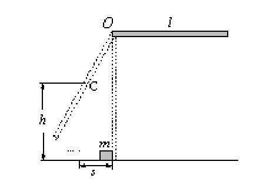

# 河南大学数学与信息科学学院 2013～2014 学年第 1 学期期末考试《普通物理（一）》试卷 B 卷参考答案及解析

**考试方式：** 闭卷
**考试时间：** 120 分钟
**卷面总分：** 100 分

---

## 一、填空题（每小题 3 分，共 30 分）

**1.** 一质点的运动方程为：$\vec{r} = (R\cos t)\vec{i} + (R\sin t)\vec{j}\ (R > 0)$，则从 $t = \pi$ 到 $t = 2\pi$ 时间内，该质点位移的大小为 ______**$2R$**______，经过的路程是 ______**$\pi R$**______。

> **【参考答案】** $2R$；$\pi R$
>
> **【解析】**
> 质点在半径为 $R$ 的圆周上作匀速率圆周运动。$t = \pi$ 时位于 $(-R, 0)$，$t = 2\pi$ 时位于 $(R, 0)$，位移 $\Delta\vec{r} = 2R\vec{i}$，大小为 $2R$；经过半个圆周，路程为 $\pi R$。

**2.** 质量为 $2\text{千克}$ 的物体，受力 $F = 4x + 4\ (\text{N})$ 的作用，从原点由静止开始沿 $x$ 轴正向运动，当物体前进 $2\text{米}$ 时，该力对物体所做的功为 ______**$16\text{ J}$**______。

> **【参考答案】** $16\text{ J}$
>
> **【解析】**
> $W = \int_0^2 (4x + 4)\,dx = \left[2x^2 + 4x\right]_0^2 = 8 + 8 = 16\text{ J}$。

**3.** 质量 $10\text{ kg}$ 的物体在力 $\vec{F} = (4 + 2t^2)\vec{i}\text{ N}$（$t$ 表示时间）的作用下沿 $x$ 轴无摩擦地运动，设 $t = 0$ 时，$v_0 = 0$，则 $3\text{ s}$ 末物体的速度 $\vec{v} =$ ______**$3\vec{i}\text{ m/s}$**______。

> **【参考答案】** $3\vec{i}\text{ m/s}$
>
> **【解析】**
> 由动量定理 $\vec{I} = \int_0^3 (4 + 2t^2)\vec{i}\,dt = \left[4t + \dfrac{2}{3}t^3\right]_0^3\vec{i} = 30\vec{i}\text{ N}\cdot\text{s} = m\vec{v} - 0$，解得 $\vec{v} = 3\vec{i}\text{ m/s}$。

**4.** 两个倾角不同，高度和质量相同的斜面放在光滑水平面上，若两个同样的小球从这两个光滑的斜面顶点由静止滑下，则小球到达斜面底端时其动量 ______**不等**______，动能 ______**不等**______。（填：相等或不等）

> **【参考答案】** 不等；不等
>
> **【解析】**
> 若斜面可在光滑水平面上自由滑动，则由水平方向动量守恒与系统机械能守恒知，因两斜面倾角不同，小球滑到底端时斜面与小球分配的动能比例不同，故小球到达底端时的动量与动能均不等（若视斜面固定，则末速度方向不同故动量不等，机械能守恒故动能相等）。

**5.** 刚体的转动惯量与 ______**刚体的质量**______，______**质量分布**______ 及 ______**转轴的位置**______ 有关。

> **【参考答案】** 刚体的质量；质量分布；转轴的位置

---

**6.** 一质点作简谐振动，已知其振动频率为 $f$，则其振动动能的变化频率为 ______**$2f$**______。

> **【参考答案】** $2f$
>
> **【解析】**
> 简谐振动动能 $E_k = \dfrac{1}{2}m\omega^2 A^2\sin^2(\omega t + \varphi) = \dfrac{1}{4}m\omega^2 A^2[1 - \cos(2\omega t + 2\varphi)]$，故动能以 $2f$ 的频率周期性变化。

**7.** 一弹簧振子在光滑水平面上作简谐振动，当振子在最大位移处时，有一块胶泥正好竖直落在该振子上，则系统的周期 ______**变**______，振幅 ______**不变**______（填：变、不变）。

> **【参考答案】** 变；不变
>
> **【解析】**
> 在最大位移处振子水平速度为零，胶泥竖直落下后水平速度仍为零，该位置仍是新的最大位移处，故振幅不变；总质量 $m$ 增大，由 $T = 2\pi\sqrt{\dfrac{m}{k}}$ 知周期变大。

**8.** 已知波源在原点，此平面简谐波的波函数为 $y = A\cos(bt - cx)$，则其波速为 ______**$\dfrac{b}{c}$**______，波长为 ______**$\dfrac{2\pi}{c}$**______。

> **【参考答案】** $\dfrac{b}{c}$；$\dfrac{2\pi}{c}$

**9.** 利用普通光源上同一点发出的光，采用 ______**分波阵面法**______ 和 ______**分振幅法**______ 两种方法可以获得两束相干光。

> **【参考答案】** 分波阵面法；分振幅法

**10.** 波长 $\lambda = 550\text{ nm}$ 的单色光垂直入射于光栅常数 $d = 1.0 \times 10^{-4}\text{ cm}$ 的光栅上，可能观察到的光谱线的最大级次为 ______**$1$**______。

> **【参考答案】** $1$
>
> **【解析】**
> 由光栅方程 $d\sin\theta = k\lambda$ 得 $k_{\max} < \dfrac{d}{\lambda} = \dfrac{1.0 \times 10^{-6}\text{ m}}{550 \times 10^{-9}\text{ m}} \approx 1.82$，取整数得最大级次为 $1$。

---

## 二、选择题（每小题 3 分，共 30 分）

**1. 质点在 $oxy$ 平面内作曲线运动，则质点速率的正确表达式为** `[ D ]`

* A. $v = \dfrac{dr}{dt}$
* B. $v = \dfrac{d\vec{r}}{dt}$
* C. $v = \dfrac{d\vert\vec{r}\vert}{dt}$
* D. $v = \sqrt{\left(\dfrac{dx}{dt}\right)^2 + \left(\dfrac{dy}{dt}\right)^2}$

> **【参考答案】** `D`

**2. 若忽略摩擦力和空气阻力，以下运动中加速度保持不变的运动是** `[ C ]`

* A. 单摆的运动
* B. 匀速率圆周运动
* C. 抛体运动
* D. 行星的椭圆轨道运动

> **【参考答案】** `C`

**3. 一段水平的公路，转弯处轨道半径为 $R$，汽车轮胎与路面间的摩擦系数为 $\mu$，要使汽车不致于发生侧向打滑，汽车在该处的行驶速率应** `[ B ]`

* A. 不得小于 $\sqrt{\mu gR}$
* B. 不得大于 $\sqrt{\mu gR}$
* C. 必须等于 $\sqrt{\mu gR}$
* D. 还应有汽车的质量决定

> **【参考答案】** `B`

**4. 对质点系有以下几种说法：(1) 质点系总动量的改变与内力无关；(2) 质点系总动能的改变与内力无关；(3) 质点系机械能的改变与保守内力无关。下列对上述说法判断正确的是** `[ B ]`

* A. 只有(1)是正确的
* B. (1)、(3)是正确的
* C. (1)、(2)是正确的
* D. (2)、(3)是正确的

> **【参考答案】** `B`

**5. 在系统不受外力作用的完全非弹性碰撞过程中下面说法正确的是** `[ C ]`

* A. 动能和动量都守恒
* B. 动能和动量都不守恒
* C. 动能不守恒，动量守恒
* D. 动能守恒，动量不守恒

> **【参考答案】** `C`

---

**6. 一个半径是 $R$ 的圆盘以角速度 $\omega$ 匀速转动，一个质量是 $m$ 的人从圆盘的边沿走到中心处，此过程中圆盘对人做的功为** `[ B ]`

* A. $mR^2\omega^2$
* B. $-mR^2\omega^2 / 2$
* C. $mR^2\omega^2 / 2$
* D. $-mR^2\omega^2$

> **【参考答案】** `B`

**7. 在光滑水平面上作简谐振动的弹簧振子，下列说法中正确的是** `[ A ]`

* A. 在平衡位置速度达最大而加速度为零
* B. 其加速度和速度的方向总相同
* C. 在平衡位置处加速度和速度同时达到最大
* D. 该系统的机械能不守恒

> **【参考答案】** `A`

**8. 下列各项中，不属于横波特征的是** `[ C ]`

* A. 质点振动方向与波的传播方向垂直
* B. 具有偏振现象
* C. 波形具有“稀疏”与“稠密”区域
* D. 波形具有波峰与波谷

> **【参考答案】** `C`

**9. 一个宇航员声称，他恰好能分辨在他下面 $100\text{ km}$ 地面上两个发射波长为 $500\text{ nm}$ 的点光源。假定宇航员的瞳孔直径为 $5.0\text{ mm}$，则此两点光源的间距为** `[ D ]`

* A. $6.1\text{ m}$
* B. $36\text{ m}$
* C. $25\text{ m}$
* D. $12.2\text{ m}$

> **【参考答案】** `D`
>
> **【解析】**
> 由瑞利判据最小分辨角 $\theta_0 = 1.22\dfrac{\lambda}{D} = \dfrac{s}{L}$，得 $s = 1.22\dfrac{\lambda L}{D} = 1.22 \times \dfrac{500 \times 10^{-9} \times 10^5}{5.0 \times 10^{-3}} = 12.2\text{ m}$。

**10. 一束部分偏振光（由自然光和线偏振光混合而成）垂直通过一偏振片，若以此入射光束为轴旋转偏振片，测得透射光强度最大值是最小值的 $5$ 倍，那么入射光束中线偏振光与自然光的强度之比为** `[ C ]`

* A. $4$
* B. $3$
* C. $2$
* D. $1$

> **【参考答案】** `C`
>
> **【解析】**
> 设自然光强为 $I_0$，线偏振光强为 $I_p$，则 $I_{\max} = \dfrac{1}{2}I_0 + I_p$，$I_{\min} = \dfrac{1}{2}I_0$。由 $\dfrac{I_{\max}}{I_{\min}} = 1 + \dfrac{2I_p}{I_0} = 5$ 得 $\dfrac{I_p}{I_0} = 2$。

---

## 三、简答题（每小题 5 分，共 10 分）

**1. 一玻璃杯从同等高度下落，若落在水泥地面易碎，而落在沙土里面可以“逃过一劫”。请用学过的物理知识给以解释。**

> **【参考答案】**
> 玻璃杯从同一高度下落，接触地面前的速度 $v$ 相同，动量 $p = mv$ 相同；最终静止，动量变化量 $\Delta p = 0 - mv = -mv$ 相同。
> 由动量定理 $I = \bar{F}\Delta t = \Delta p$ 可知：
> - 落在水泥地面上时，缓冲作用时间 $\Delta t$ 极短，地面给玻璃杯的平均冲力 $\bar{F} = \dfrac{\Delta p}{\Delta t}$ 极大，超过玻璃杯能承受的极限强度，因此容易碎裂；
> - 落在沙土里面时，沙土发生形变缓冲，使作用时间 $\Delta t$ 显著增长，从而大大减小了玻璃杯受到的平均冲力 $\bar{F}$，故可以“逃过一劫”。

**2. 利用所学知识列举出测量光波波长的两种方法，并简要说明其原理。**

> **【参考答案】**
> 1. **杨氏双缝干涉法（或迈克耳孙干涉仪法）**：
>    利用分波阵面法产生双光束干涉，相邻明（或暗）条纹间距为 $\Delta x = \dfrac{D}{d}\lambda$。通过测量双缝间距 $d$、缝到屏的距离 $D$ 以及相邻条纹间距 $\Delta x$，即可由 $\lambda = \dfrac{d\Delta x}{D}$ 求出光波波长。
>    （若用迈克耳孙干涉仪，动镜移动距离 $\Delta d$ 时条纹移动数目为 $N$，由 $\Delta d = N\dfrac{\lambda}{2}$ 得 $\lambda = \dfrac{2\Delta d}{N}$。）
> 2. **衍射光栅法**：
>    单色平行光垂直入射到光栅常数已知为 $d = a + b$ 的透射光栅上，由光栅方程 $d\sin\theta = k\lambda\ (k = 1, 2, \dots)$，用分光计测出第 $k$ 级主极大的衍射角 $\theta$，即可由 $\lambda = \dfrac{d\sin\theta}{k}$ 精确测出光波波长。

---

## 四、计算题（1 题 12 分，2、3 题各 9 分，共 30 分）

**1. 如图所示，有一长度为 $l$、质量为 $m$ 的均匀细杆，一端可绕垂直于细杆的水平光滑固定转轴 $O$ 在竖直平面内转动。当细杆从水平位置自由释放后，它在竖直位置与放在地面上的一个质量同为 $m$ 的静止小滑块发生碰撞。小滑块与地面间的摩擦系数为 $\mu$，碰撞后小滑块移动距离 $s$ 后停止，而细杆则沿原转动方向继续转动。求：碰撞后细杆中点 $C$ 离地面的最大高度 $h$。**

  
  
<em>图1：细杆与小滑块碰撞示意图</em>

> **【参考答案】**
> 1. **细杆从水平位置摆至竖直位置（碰撞前瞬间）**：
>    由机械能守恒定律（转动惯量 $J = \dfrac{1}{3}ml^2$）：
>
> $$
> mg\frac{l}{2} = \frac{1}{2}J\omega_0^2 = \frac{1}{2}\left(\frac{1}{3}ml^2\right)\omega_0^2 \implies \omega_0 = \sqrt{\frac{3g}{l}}
> $$
>
> 2. **碰撞后小滑块滑行过程**：
>    设碰撞后瞬间小滑块的速度为 $v$，由动能定理：
>
> $$
> -\mu mgs = 0 - \frac{1}{2}mv^2 \implies v = \sqrt{2\mu gs}
> $$
>
> 3. **碰撞过程角动量守恒**：
>    以细杆和小滑块为系统，碰撞瞬间对转轴 $O$ 的外力矩为零，角动量守恒。设碰撞后细杆角速度为 $\omega$：
>
> $$
> J\omega_0 = J\omega + mvl \implies \frac{1}{3}ml^2\omega_0 = \frac{1}{3}ml^2\omega + ml\sqrt{2\mu gs}
> $$
>
>    解得碰撞后细杆的角速度：
>
> $$
> \omega = \omega_0 - \frac{3\sqrt{2\mu gs}}{l} = \frac{\sqrt{3gl} - 3\sqrt{2\mu gs}}{l}
> $$
>
> 4. **碰撞后细杆继续摆动至最高点**：
>    由机械能守恒定律，细杆质心 $C$ 上升的高度为 $\Delta h = h - \dfrac{l}{2}$：
>
> $$
> mg\left(h - \frac{l}{2}\right) = \frac{1}{2}J\omega^2 = \frac{1}{6}ml^2\omega^2
> $$
>
>    代入 $\omega$ 得碰撞后细杆中点 $C$ 离地面的最大高度为：
>
> $$
> h = \frac{l}{2} + \frac{l^2\omega^2}{6g} = \frac{l}{2} + \frac{\left(\sqrt{3gl} - 3\sqrt{2\mu gs}\right)^2}{6g}
> $$

---

**3. 一波源作简谐振动，振幅为 $A$，周期为 $0.01\text{ s}$，经平衡位置向正方向运动时，作为计时起点。设此振动以 $400\text{ m/s}$ 的速度沿 $x$ 轴正向传播，求该波动的波函数。（注：原卷题号印为 3）**

> **【参考答案】**
> 1. **求波源的振动方程**：
>    角频率为：
>
> $$
> \omega = \frac{2\pi}{T} = \frac{2\pi}{0.01} = 200\pi\text{ rad/s}
> $$
>
>    设波源（$x = 0$ 处）的简谐振动方程为 $y_0(t) = A\cos(\omega t + \varphi_0)$。
>    因为 $t = 0$ 时质点经平衡位置向正方向运动，即 $y_0(0) = 0$ 且 $v_0(0) = -A\omega\sin\varphi_0 > 0$，故初相位 $\varphi_0 = -\dfrac{\pi}{2}$。
>    波源振动方程为：
>
> $$
> y_0(t) = A\cos\left(200\pi t - \frac{\pi}{2}\right)
> $$
>
> 2. **写出波函数**：
>    波以 $u = 400\text{ m/s}$ 沿 $x$ 轴正向传播，故波动的波函数为：
>
> $$
> y(x, t) = A\cos\left[200\pi\left(t - \frac{x}{400}\right) - \frac{\pi}{2}\right] = A\cos\left(200\pi t - \frac{\pi}{2}x - \frac{\pi}{2}\right)\ (\text{m})
> $$

---

**4. 一杨氏双缝装置的两个缝分别被折射率为 $n_1 = 1.40$、$n_2 = 1.70$ 的薄玻璃片所遮盖。玻璃片插入以后，屏上原来中央极大（明条纹）所在位置，现变为第五级明纹。假定双缝间距 $d = 0.5\text{ mm}$，双缝到屏的距离 $D = 2.5\text{ m}$，光源波长 $\lambda = 480\text{ nm}$，且两玻璃片厚度均为 $e$，试求：（1）薄玻璃片厚度 $e$；（2）中央明纹现在距屏幕中心的位置。（注：原卷题号印为 4）**

> **【参考答案】**
> 1. **求薄玻璃片厚度 $e$**：
>    插入两块厚度均为 $e$ 的薄玻璃片后，两束相干光在屏幕中心 $O$ 处引起的附加光程差为：
>
> $$
> \Delta = \vert n_2 - n_1 \vert e
> $$
>
>    由题意，屏幕中心 $O$ 处现变为第 $k = 5$ 级明条纹，故有：
>
> $$
> (n_2 - n_1)e = k\lambda = 5\lambda
> $$
>
>    代入数据 $n_1 = 1.40, n_2 = 1.70, \lambda = 480 \times 10^{-9}\text{ m}$ 得：
>
> $$
> e = \frac{5\lambda}{n_2 - n_1} = \frac{5 \times 480 \times 10^{-9}}{1.70 - 1.40} = 8.0 \times 10^{-6}\text{ m} = 8.0\ \mu\text{m}
> $$
>
> 2. **求中央明纹现在距屏幕中心的位置**：
>    中央明纹对应总光程差为零的位置，向折射率较大的 $n_2$ 一侧移动 $5$ 个条纹间距。
>    相邻明纹间距为：
>
> $$
> \Delta x = \frac{D}{d}\lambda = \frac{2.5}{0.5 \times 10^{-3}} \times 480 \times 10^{-9} = 2.4 \times 10^{-3}\text{ m} = 2.4\text{ mm}
> $$
>
>    因此中央明纹现在距屏幕中心的距离为：
>
> $$
> x_0 = 5\Delta x = 5 \times 2.4\text{ mm} = 12\text{ mm} = 1.2 \times 10^{-2}\text{ m} \quad (\text{偏向 } n_2 = 1.70 \text{ 玻璃片一侧})
> $$
