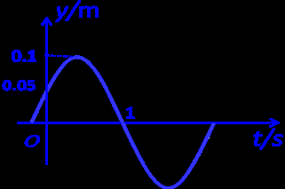

# 河南大学数学与统计学院 2014～2015 学年第 1 学期期末考试《普通物理（一）》试卷 A 卷

**考试方式：** 闭卷
**考试时间：** 120 分钟
**卷面总分：** 100 分

---

## 一、填空题（每小题 3 分，共 30 分）

**1. 一小球沿斜面向上运动，其运动方程为：$x = 5 + 4t - t^2$，则小球运动到最高点的时刻 $t =$______$\text{s}$。**

**2. 一个圆周运动的质点，一定改变的是______加速度，有可能不变的是______加速度。（填：切向或法向）**

**3. 假定卫星环绕地心作椭圆运动，则在运动过程中卫星的动量______，对地心的角动量______。（填：守恒或不守恒）**

**4. 细棒可绕着通过棒的一个端点并与棒垂直的光滑轴转动，在棒从水平位置转到竖直位置的过程中，其角速度______，角加速度______。（填：变大、变小或者不变）**

**5. 一弹簧振子在光滑水平面上作简谐振动，当振子在最大位移处时，有一块橡皮泥正好竖直落在该振子上，则系统的周期将______，其振幅将______。（填：变大、变小或者不变）**

---

**6. 已知波源在原点，此平面简谐波的波动方程为：$y = A\cos(bt - cx)$，其中 $A$、$b$、$c$ 为正的常数，则其波速为______，波长为______。**

**7. 在垂直照射的劈尖干涉实验中，当劈尖的夹角变大时，干涉条纹的数目将______，条纹间距将______。（填：增大、减小或者不变）**

**8. 在单缝夫琅和费衍射中，若单缝两边缘点 $A$、$B$ 发出的单色平行光到屏幕上点 $P$ 的光程差为 $1.5\lambda$，则 $A$、$B$ 间可分为______个半波带，$P$ 点处为______条纹。**

**9. 迎面驶来的汽车两盏前灯相距 $1.22\text{ m}$，则当汽车距离人______米时，人眼睛恰能分辨这两盏前灯。设夜间瞳孔直径为 $0.55\text{ mm}$，而入射光波长为 $550.0\text{ nm}$。**

**10. 一束平行的自然光，以 $60^\circ$ 角从空气中入射到平玻璃表面上，若反射光是完全偏振的，则折射光束的折射角为______；玻璃的折射率为______。**

---

## 二、选择题（每小题 3 分，共 30 分）

**1. 沿直线运动的物体，其速度与时间成反比，则其加速度的大小** `[   ]`

* A. 与时间成正比
* B. 与时间平方成正比
* C. 与时间平方成反比
* D. 与速度平方成反比

**2. 用枪射击挂在空中的目标 $M$，当子弹从枪口射出时，$M$ 正好由静止自由下落，如不计阻力，要想击中 $M$，枪口应瞄准** `[   ]`

* A. $M$ 的下方
* B. $M$ 的上方
* C. $M$ 本身
* D. 无法判断

**3. 对质点系有以下几种说法：(1) 质点系总动量的改变与内力无关；(2) 质点系总动能的改变与内力无关；(3) 质点系机械能的改变与保守内力无关。下列对上述说法判断正确的是** `[   ]`

* A. 只有(1)是正确的
* B. (1)、(3)是正确的
* C. (1)、(2)是正确的
* D. (2)、(3)是正确的

**4. 质点在外力作用下运动时，下列说法中正确的是** `[   ]`

* A. 外力的功为零，外力的冲量一定为零
* B. 外力的冲量为零，外力的功一定为零
* C. 外力的冲量不为零，外力的功也不为零
* D. 外力的功不为零，外力的冲量不一定为零

**5. 一个半径是 $R$ 的圆盘以角速度 $\omega$ 匀速转动，一个质量是 $m$ 的人从圆盘的边沿走到中心处，此过程中圆盘对人做的功为** `[   ]`

* A. $mR^2\omega^2$
* B. $-mR^2\omega^2$
* C. $mR^2\omega^2 / 2$
* D. $-mR^2\omega^2 / 2$

---

**6. 关于力矩有以下几种说法，其中正确的是** `[   ]`

* A. 内力矩会改变刚体对某个定轴的角动量
* B. 质量相等、形状和大小不同的两个刚体，在相同力矩的作用下，它们的角加速度一定相等
* C. 角速度的方向一定与外力矩的方向相同
* D. 作用力和反作用力对同一轴的力矩之和必为零

**7. 下列关于简谐振动与简谐波的说法，不正确的是** `[   ]`

* A. 简谐振动的动能和势能具有相反的相位，波的动能和势能具有相同的相位
* B. 媒质中质点振动的速度就是相应波的波速
* C. 沿同一直线相反方向传播且振幅相等的两列相干简谐波相遇时可以形成驻波
* D. 两个等振幅、同振动方向、频率相近但都较大的谐振动合成将产生拍现象

**8. 人耳能辨别同时传来的不同声音，这是由于波的** `[   ]`

* A. 独立传播特性
* B. 干涉特性
* C. 反射和折射特性
* D. 强度不同

**9. 用波长 $\lambda = 600\text{ nm}$ 的单色光做杨氏双缝实验，在光屏 $P$ 处产生第五级明纹极大，现将折射率 $n = 1.5$ 的薄透明玻璃片盖在其中一条缝上，此时 $P$ 处变成中央明纹极大的位置，则此玻璃片厚度为** `[   ]`

* A. $5 \times 10^{-4}\text{ cm}$
* B. $6 \times 10^{-4}\text{ cm}$
* C. $7 \times 10^{-4}\text{ cm}$
* D. $8 \times 10^{-4}\text{ cm}$

**10. 在光栅光谱中，假如所有偶数级次的主极大都恰好在每缝衍射的暗纹方向上，即偶数级次的主极大均不出现，那么此光栅的缝宽度 $a$ 和缝间不透光部分宽度 $b$ 的关系为** `[   ]`

* A. $a = b$
* B. $a = 2b$
* C. $a = 3b$
* D. $b = 2a$

---

## 三、简答题（每小题 5 分，共 10 分）

**1. 一玻璃杯从同等高度下落，若落在水泥地面易碎，而落在沙土里面可以“逃过一劫”。请用学过的物理知识给以解释。**

**2. 试用力学定律分析花样滑冰，旋转着的芭蕾舞演员要加速旋转时，为什么总是将双手收回身边。在这个过程中，演员的转动动能是增大、减小还是不变，为什么？**

---

## 四、计算题（每题 10 分，共 30 分）

**1. 质量 $m = 4\text{ kg}$ 的物体沿 $x$ 轴无摩擦地运动，$t = 0$ 时，物体位于原点，速度 $v_0 = 0$。若物体在力 $F = 5 + 3x^2$ 作用下移动了 $2\text{ m}$，试求：（1）力 $F$ 在此过程中对物体所作的功 $A$；（2）物体的末速度 $v$ 和末动量 $p$ 的大小。**

---

**2. 一波源作简谐振动，其振动曲线如图所示。设此振动以 $20\text{ m/s}$ 的速度沿 $x$ 轴正向传播，求该波动的波函数。**

  
  
<em>图1：波源简谐振动曲线图</em>

---

**3. 某湖水（$n_1 = 1.15$）表面有一层厚度 $d = 460\text{ nm}$ 的油膜（$n_2 = 1.20$），若从该油膜正上方向下观察，试问看到的油膜呈什么颜色？若潜水员潜入湖水中并向正上方观察，则看到的油膜又呈什么颜色？**
